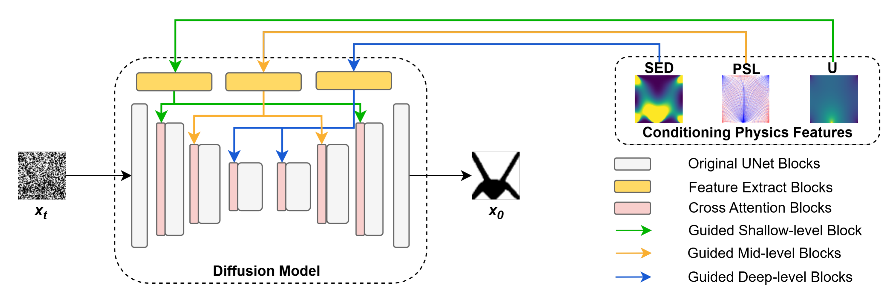

# HPG-Diff

**Hierarchical Physics-Guided Diffusion with Differentiable Connectivity Constraints for Topology Optimization**

Official implementation of ["HPG-Diff: Hierarchical physics-guided diffusion with differentiable connectivity constraints for topology optimization"](https://doi.org/10.1016/j.asoc.2026.115899), Jinbo Yang, Mingyue Yuan, Boyuan Zhang, Yoshifumi Kitamura, and Shikai Jing, *Applied Soft Computing*, 2026.

[Paper](https://doi.org/10.1016/j.asoc.2026.115899) · [arXiv](https://arxiv.org/abs/2607.07233) · [Dataset](https://huggingface.co/datasets/scottyjb/HPGDiff)

## Overview

HPG-Diff generates structural topologies for specified loads, supports, and volume fractions. It combines two forms of physics guidance:

- **Hierarchical conditioning:** displacement (U), principal stress lines (PSL), and strain energy density (SED) guide shallow, middle, and deep UNet layers through cross-attention.
- **Connectivity regularization:** a floating material suppression loss uses virtual heat propagation from load positions to penalize disconnected material during training.

LoRA fine-tuning supports adaptation to non-square design domains with a small target dataset.



*Figure 4 from the paper: physics features guide the denoising network at different depths.*

## Installation

```bash
pip install -r requirements.txt
```

Training and sampling require a CUDA-capable GPU.

## Dataset

The [HPGDiff dataset](https://huggingface.co/datasets/scottyjb/HPGDiff) contains the training examples and both evaluation benchmarks used in the paper.

| Configuration | Split | Examples | Description |
|---|---|---:|---|
| `train` | `train` | 30,000 | Training topologies and conditioning physics fields |
| `test` | `test_level_1` | 1,800 | In-distribution boundary conditions |
| `test` | `test_level_2` | 1,000 | Out-of-distribution boundary conditions |

```python
from datasets import load_dataset

train = load_dataset("scottyjb/HPGDiff", "train", split="train")
test_1 = load_dataset("scottyjb/HPGDiff", "test", split="test_level_1")
test_2 = load_dataset("scottyjb/HPGDiff", "test", split="test_level_2")
```

Training, sampling, and evaluation use these configurations through `hpgdiff/datasets.py`.

## Training

```bash
python scripts/diffusion_training.py
```

Checkpoints and logs are written under `checkpoints/`.

## Sampling and Evaluation

Sample from a trained checkpoint:

```bash
python evaluation/hpgdiff_sample.py \
  --model_path checkpoints/diff_logdir_1/model120000.pt --test_level 1 \
  --image_size 64 --num_channels 128 --num_res_blocks 3 \
  --use_spatial_transformer True --learn_sigma True \
  --dropout 0.3 --use_fp16 True \
  --diffusion_steps 1000 --noise_schedule cosine --timestep_respacing 100
```

Generate samples and evaluate a checkpoint:

```bash
python evaluation/eval_checkpoints.py --dir ../checkpoints/diff_logdir_1 --model 120000 --test_level 1
```

Use `--test_level 2` for the out-of-distribution benchmark. The `--model` argument selects `model<step>.pt` from the checkpoint directory.

## LoRA Fine-Tuning

Prepare the rectangular-domain examples under `LoRA_scripts/LoRA_data/` and set the pretrained checkpoint in `LoRA_scripts/LoRA_diffusion.py`.

```bash
cd LoRA_scripts
bash run_training.sh
```

The local LoRA data contains topology images, physical fields, principal stress lines, displacement masks, and load fields. It is separate from the square-domain Hugging Face dataset.

## Citation

```bibtex
@article{yang2026hpgdiff,
  title   = {{HPG-Diff}: Hierarchical physics-guided diffusion with differentiable connectivity constraints for topology optimization},
  author  = {Yang, Jinbo and Yuan, Mingyue and Zhang, Boyuan and Kitamura, Yoshifumi and Jing, Shikai},
  journal = {Applied Soft Computing},
  volume  = {202},
  pages   = {115899},
  year    = {2026},
  doi     = {10.1016/j.asoc.2026.115899}
}
```

## License

Current author contributions and the dataset are released under [CC BY-NC 4.0](https://creativecommons.org/licenses/by-nc/4.0/). Previously released MIT material retains its original permissions; see [LICENSE-MIT](LICENSE-MIT). Third-party components retain their original licenses.
